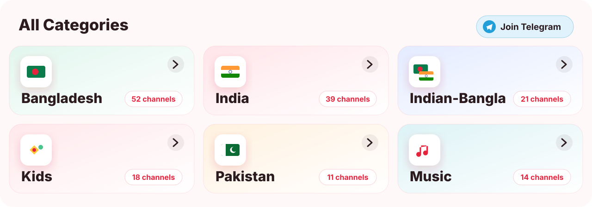
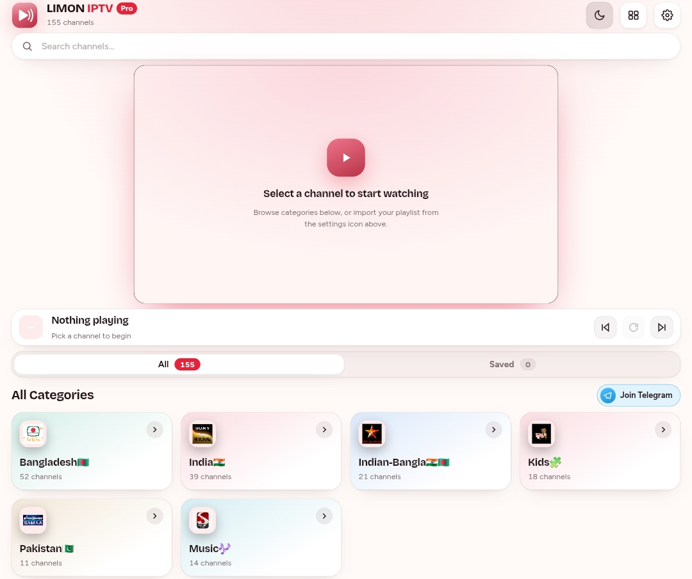
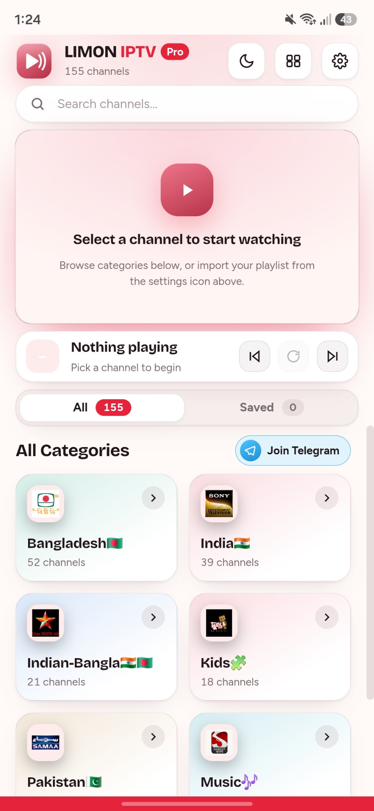
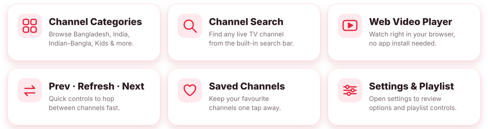
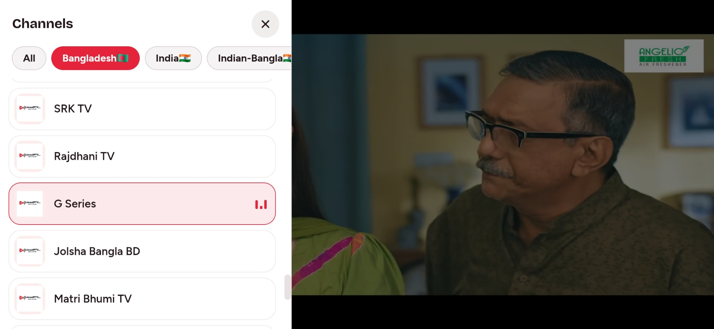

 

&nbsp;&nbsp;

 

  

## ❤️ Welcome to LIMON IPTV PRO

**LIMON IPTV PRO** (**LimonIPTVpro WebApp**) is a browser-based **web IPTV player** and **live TV** experience made with **Bangladesh 🇧🇩 and India 🇮🇳** viewers in mind. Browse **BD live TV** and Indian channel categories, search for channels, use the player controls, and switch channels in fullscreen — all from your browser, on desktop or mobile.

> 🔎 **Looking for a web player for Bangla and Indian live TV?** Open the website, pick a category and start browsing.

🌐 <a href="https://limon-iptv-pro.vercel.app/">limon-iptv-pro.vercel.app</a>

## 📂 Channel Categories

Pick a category, just like on the website.

  

Channel counts are taken from the supplied homepage screenshot and may change as the website is updated.

## 🖼️ Website Homepage Preview

See the actual website interface on desktop and mobile.

<table>
  <tr>
    <td align="center" width="68%">
      <strong>🖥️ Desktop Homepage</strong>  
      
    </td>
    <td align="center" width="32%">
      <strong>📱 Mobile Homepage</strong>  
      
    </td>
  </tr>
</table>

These are screenshots supplied by the website owner. They show the website interface and are not recreated mockups.

## ✨ Features to Explore

  

Feature availability and behavior may change as the website is updated. Visit the live website for the current experience.

## 🌟 Signature Highlight — Switch Channels Without Leaving Fullscreen

Bring up the **Channels** panel alongside video playback and choose another channel while the video stays in the fullscreen viewing layout.

> **Keep watching. Open the channel list. Pick another channel.**

**Fullscreen Channel Switching — Website Feature Preview**

This can make channel browsing more convenient by reducing the need to leave the viewing screen just to select another channel. Exact behavior can vary depending on browser, device, screen size, and playback source.

## 📺 Device & Browser Experience

LIMON IPTV PRO is accessed through a web browser. The supplied screenshots show desktop and mobile layouts.

Playback support and performance may depend on the browser, operating system, device capabilities, network connection, and stream format or provider. We do not promise universal compatibility or uninterrupted playback.

## 💬 Join the LIMON IPTV PRO Community

Stay connected, share feedback, ask questions, and suggest improvements through our Telegram community.

### Channel Requests & Feedback

You can share channel suggestions, report website issues, or send feedback through the Telegram community. Requests are not guaranteed to be added; availability depends on lawful permissions, source availability, and technical factors.

## ❓ Frequently Asked Questions

<strong>What is LIMON IPTV PRO?</strong>

LIMON IPTV PRO is a browser-based web IPTV player and live TV experience for Bangladesh and India viewers. Visit the official website to explore the current interface and available features.

<strong>Is there a web IPTV player for BD live TV and Indian channels?</strong>

LIMON IPTV PRO is a web player with Bangladesh, India, Indian-Bangla, Kids, Pakistan and Music categories. Open it in your browser on desktop or mobile: [limon-iptv-pro.vercel.app](https://limon-iptv-pro.vercel.app/).

<strong>Do I need to install an app?</strong>

No installation is shown in the website flow — LIMON IPTV PRO is used through a web browser.

<strong>Can I change channels while staying in fullscreen?</strong>

The supplied feature screenshot shows a channel-selection panel displayed beside video playback, allowing a viewer to select another channel from that panel while the video remains in the viewing layout. Behavior may vary by device and browser.

<strong>Does this GitHub repository contain the application or streams?</strong>

No. This is a promotional repository only. It does not include application source code, playlists, credentials, stream URLs, or broadcast content.

<strong>Why might a channel not play?</strong>

Playback can be affected by source availability, provider changes, regional restrictions, network conditions, browser support, or device compatibility.

<strong>Where can I send feedback or channel requests?</strong>

Join the [Telegram community](https://t.me/+pSagWxGEpss1MmI1).

## ⚖️ License, Copyright & Disclaimer

  

| 📜 [LICENSE](LICENSE) | ©️ [COPYRIGHT.md](COPYRIGHT.md) | ⚠️ [DISCLAIMER.md](DISCLAIMER.md) | 🤝 [CONTRIBUTING.md](CONTRIBUTING.md) |
|:--:|:--:|:--:|:--:|
| Original written docs under **CC BY 4.0** | Third-party content stays with its owners | Promo repo — no streams or playlists | How to help improve this page |

IPTV may involve television broadcasts and other material protected by copyright or related rights. **A stream being technically accessible does not automatically mean that it is licensed or authorized for every use.**

- LIMON IPTV PRO and this repository do not claim ownership of third-party channels, broadcasts, streams, programme titles, logos, trademarks, artwork, or media.
- Users should access only content they are legally entitled to view and must follow applicable laws and provider terms.
- Do not use the website or this repository to facilitate unauthorized retransmission, recording, copying, or redistribution of protected content.
- Channel availability may depend on external sources and can change without notice.
- This repository does not host or distribute television broadcasts, playlists, credentials, or stream links.

**Rights-holder concerns:** please use a verified contact route published by the relevant website operator or provider, or ask through the [Telegram community](https://t.me/+pSagWxGEpss1MmI1) for the concern to be directed to the operator. This repository does **not** claim to be the operator's designated DMCA agent or formal legal-notice address. See [COPYRIGHT.md](COPYRIGHT.md) and [DISCLAIMER.md](DISCLAIMER.md).

**License scope:** original written promotional documentation here is offered under **Creative Commons Attribution 4.0 International (CC BY 4.0)**, subject to the exclusions in [LICENSE](LICENSE). The screenshots may contain third-party logos, channel artwork, names, or other material; the repository license does not grant rights to those elements. The LIMON IPTV PRO name identifies the website being promoted; no third-party endorsement or affiliation is implied.

## 🔎 Also Known As / Search Keywords

<strong>Click to expand keywords</strong>

 

**English:** LimonIPTVpro · Limon IPTV Pro · LimonIPTVpro WebApp · web IPTV player · IPTV web player · IPTV webapp · web player · live TV · live TV online · online TV · BD live TV · Bangladesh live TV · Bangladesh IPTV · India live TV · India IPTV · Bangla TV · Bangla live TV · Bangla IPTV · Bengali TV · Indian Bangla channels · Indian TV channels · Pakistan TV · BDIX web player · BDIX IPTV · BDIX live TV · Bangladesh and India IPTV website · browser IPTV player · IPTV player for desktop and mobile · fullscreen channel switching

**বাংলা / Banglish:** লিমন আইপিটিভি · লাইভ টিভি · বিডি লাইভ টিভি · বাংলা লাইভ টিভি · বাংলাদেশি টিভি চ্যানেল · ইন্ডিয়ান বাংলা চ্যানেল · ওয়েব আইপিটিভি প্লেয়ার · bd live tv · bangla tv live · bangla tv channel · bd tv online · web iptv bd

 

### 🔴 Ready to Explore?

&nbsp;&nbsp;

 

Made for the LIMON IPTV PRO community · Promotional repository only · ⭐ Star this repo to help others find it

